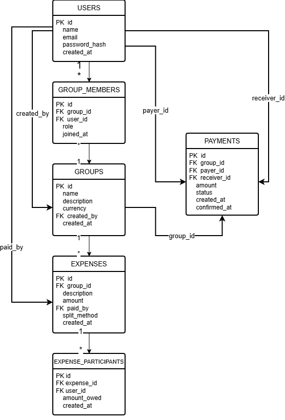

# SPLITMate

SPLITMate tracks shared group expenses while keeping accounts optional for guests. The current application uses Next.js App Router, TypeScript, Tailwind CSS, Prisma 8 RC and Prisma-hosted PostgreSQL.

## Current Progress

Completed:

- Owner registration, login and sign-out with hashed, database-backed UserSession authentication.
- Persisted dashboard/groups and transactional group creation with owner/guest GroupMembers.
- Owner-only group detail page, member list, recent activity and reusable share-link UI.
- Public guest invites and concurrency-safe member claiming with MEMBER_CLAIMED logging.
- Hashed GuestSession authentication and cross-group access isolation.
- Protected guest group page showing the current identity, active members and recent activity.
- Throttled guest activity tracking and device sign-out without resetting claimedAt.
- Shared expense context resolves authenticated owners and guests to active same-group GroupMembers and returns only safe form data.
- Reusable expense form for both flows: description, amount, current-member payer default and participant checkboxes. Available from each group page.
- Server-validated equal splitting in integer pence, split review/edit/confirmation, and transactional expense/participant creation with EXPENSE_CREATED logging.
- Editable custom shares with exact assigned/remaining totals, reset to equal and server validation.
- Improved owner/guest headers, identity, member states and activity panels.
- Saved expense lists on owner and guest group pages, including payer, total, date, participant count and expandable split amounts.
- Automated testing: **334 tests passing**; see [verification results](docs/tests.md).

**Next development area: Group balances**

Equal/custom splitting and expense persistence are implemented for GBP groups. The server calculates shares for review, revalidates on confirmation and saves all records together. Balances, expense editing, percentage splits, payments and settlements remain pending.

## Access model

Only the owner needs an account. Guests open a shared link, choose an existing unclaimed name and enter the protected group page. Disabling invitations blocks new claims while existing valid guests retain access. Owner and guest sessions remain separate.

One guest identity is remembered per browser. Signing out, losing or expiring its cookie leaves that member claimed; session recovery is not implemented. Invite links should only be shared with intended members.

## Development

Use Node 24 (the test harness uses Node module hooks), `npm ci` and `npm run dev` with privately configured database connections. Use the locally installed Prisma CLI; do not upgrade the RC packages or apply migrations as part of ordinary setup.

See [tests and verification](docs/tests.md) for commands, coverage, manual evidence and limitations.

**Documentation convention:** future milestones must update relevant documentation, this README's progress and `docs/tests.md` whenever behaviour or testing changes.

## Documentation

- [Architecture, authentication and routing](docs/architecture.md)
- [Database design](docs/database-design.md)
- [Group creation and owner reads](docs/group-creation.md)
- [Project structure](docs/project-structure.md)
- [Testing](docs/tests.md)
- [Progress history](docs/progress-report.md) and [roadmap](docs/dev-roadmap.md)
- [Requirements](docs/requirements.md) and [user stories](docs/user-stories.md)

Original notes and diagrams below are historical, not current implementation guidance.

---

Historical original notes - not current implementation

## Original notes — preserved

The following notes are retained as originally written. For current implementation status, use the dated update above.

SplitMate is a group expense management application designed to
simplify tracking shared expenses and repayments between friends.

See the current development roadmap progress:
[Development Roadmap](docs/dev-roadmap.md)

## Problem

When a large group participates in an activity, one person may pay
for everyone. Tracking who owes what through WhatsApp messages,
notes or spreadsheets can become difficult.

See the user stories:
[User Stories](docs/user-stories.md)

## Solution

SplitMate maintains a centralised expense ledger that calculates
individual balances and provides an optimised settlement plan.

## Planned Features

- User accounts
- Groups
- Group invitations
- Shared expenses
- Equal and unequal splitting
- Balance calculation
- Payment tracking
- Settlement optimisation
- Notifications

## Planned Technology

Frontend:
Next.js / React / TypeScript

Backend:
Python / FastAPI

Database:
PostgreSQL

Deployment:
Docker / Cloud infrastructure

CI/CD:
GitHub Actions

See the planned application requirements:
[Requirements](docs/requirements.md)

## System Architecture

The following diagram illustrates the planned architecture of SplitMate
and the communication between the frontend, backend and database.

See the full system architecture documentation:
[Architecture Design](docs/architecture.md)

## Database Design

SplitMate uses PostgreSQL to store users, groups, expenses,
participants and repayments.

The database follows a relational structure with foreign keys
used to maintain relationships between users, groups and expenses.

See the full database design documentation:
[Database Design](docs/database-design.md)

## Current Progress

SPLITMate is currently in the backend authentication stage.

Completed:

- Project requirements and feature planning
- Initial system design
- Database ERD
- Database schema design
- Next.js project setup
- Initial dashboard and group creation pages
- Prisma and PostgreSQL setup
- Prisma data contract generation
- Initial database migration created and applied
- Database tables, relationships, indexes, and constraints created
- Database migration status verified
- Next.js successfully connected to PostgreSQL through Prisma
- Test user successfully created and retrieved from the database
- `bcryptjs` installed for password hashing
- Server-only transactional group creation service; authentication and UI integration are pending ([backend details](docs/group-creation.md))

Currently working on:

- Building the user registration API
- Validating registration data
- Hashing user passwords securely
- Saving registered users to PostgreSQL

Next:

- Implement user login and authentication
- Connect group creation to the database
- Add group member functionality
- Begin expense and payment functionality

