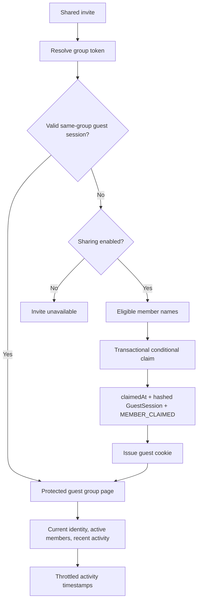

# SPLITMate Architecture

## Runtime and identity

Next.js App Router hosts pages, route handlers, Server Actions and server-only data services. React and Tailwind provide the UI; `src/prisma/db.ts` connects the pinned Prisma 8 RC runtime to Prisma-hosted PostgreSQL. There is no separate FastAPI backend.

A User is an account; a GroupMember is an identity inside one group. Only owners require accounts. All financial relationships reference GroupMember, including guests with null userId.

## Authentication

| Concern | Owner | Guest |
| --- | --- | --- |
| Establish identity | bcrypt-verified login | Claim an eligible owner-defined member through an enabled invite |
| Session model | UserSession → User | GuestSession → GroupMember |
| Expiry | Eight hours | 30 days; activity does not extend expiry |
| Cookie | Owner-specific host-only HttpOnly cookie | Separate guest-specific host-only HttpOnly cookie |
| Access check | Verified owner ID and Group.createdBy | Valid session, active claimed MEMBER with null userId, matching group |
| Sign-out | Revoke browser owner sessions, clear owner cookies | Revoke browser guest sessions, clear guest cookies; preserve claimedAt |

Both session types use 32 random bytes and store only SHA-256 token hashes. Shared helpers validate canonical base64url tokens. Cookies use SameSite=Lax; production uses Secure and the `__Host-` prefix. Owner issuance also supports an HTTPS development cookie. Guest issuance uses the local cookie outside production.

Registration normalizes email and hashes passwords with bcrypt cost 12; passwords are not trimmed and require 15 characters minimum, 72 UTF-8 bytes maximum. Registration does not issue a session. HTTP mutation endpoints enforce same origin; Server Actions use Next.js's action request protection and revalidate identity/input server-side.

Session reads reject malformed, missing, expired or unusable credentials. Server Components do not mutate cookies during rendering. Explicit sign-out clears cookies only after successful revocation.

## Guest flow

Claim eligibility is active, unclaimed, role MEMBER and null userId, in the group resolved from the token. Conditional `updateAll()` writes retain guards in SQL: the group write coordinates claiming with link changes, and the member write prevents two successful claims. Session/event creation shares the transaction. This RC's single-row `update()` first resolves an ID, so it is not used for these guarded writes.

Sharing controls new invitations, not existing membership. Disabling sharing preserves valid guest access; inactive membership blocks it. Rotating a token would make old URLs unresolvable, including for existing guests. Rotation/disable UI is not implemented.

## Routing and data boundaries

| Route | Behaviour |
| --- | --- |
| `/` | Session-aware landing actions |
| `/register`, `/login` | Owner authentication; allowed return paths are dashboard/group creation |
| `/dashboard` | Owner's groups, active-member counts and latest five owned-group events |
| `/groups/new` | Owner-only creation form → POST /api/groups |
| `/groups/[groupId]` | Ownership checked server-side; active members, latest 10 events and share UI |
| `/g/[shareToken]` | Invite; existing same-group guests redirect to /group even when sharing is disabled |
| `/g/[shareToken]/group` | Matching guest session required; failures redirect to invite without private lists |
| `/g/[shareToken]/joined` | Compatibility redirect to the protected /group destination |

Successful claims go directly to the guest group page. Guest sign-out returns to the invite without making the identity claimable again. Invalid token paths use a fixed safe destination. Unexpected protected-group/action failures produce generic messages.

Guest output contains only group/current-member identity, active member names/joined status and up to 10 events ordered by timestamp and ID descending. Allowed events are GROUP_CREATED, MEMBER_CLAIMED, MEMBER_ADDED and MEMBER_REMOVED. Other event types need an explicit visibility decision. Owner account data, authentication fields and financial data are excluded.

Guest group reads and activity updates share a transaction. lastSeenAt and lastActiveAt each refresh when at least five minutes old; observed-value guards avoid overwriting newer timestamps. No page-view ActivityEvents are created. Guest pages are dynamic and set noindex/no-referrer metadata.

## Limits and next work

One current guest cookie per browser; no session recovery, identity switching or multi-group guest-session UI. Rate limiting and live database concurrency/rollback testing remain outstanding. Group creation has no server-side idempotency guarantee.

Next: **Expense creation and splitting**. See [testing evidence](tests.md), [owner data flow](group-creation.md) and [database design](database-design.md).

---

Historical original notes - not current implementation

## Original notes — preserved

The following notes are retained as originally written. For current implementation status, use the dated update above.

## Overview

SplitMate will use a client-server architecture consisting of a web frontend, REST API backend and relational PostgreSQL database.

The frontend will be responsible for presenting the user interface and communicating with the backend through HTTPS requests.

The backend will contain the application's business logic, including expense calculations, balance calculations, group management and payment tracking.

PostgreSQL will provide persistent storage for users, groups, expenses and payments.

## Planned Architecture

The main components are:

* **Frontend:** Next.js, React and TypeScript
* **Backend:** Python and FastAPI
* **Database:** PostgreSQL
* **API:** RESTful API
* **Version Control:** Git and GitHub

## Data Flow

When a user creates an expense, the frontend sends the expense information to the FastAPI backend through the REST API.

The backend validates the request, calculates the relevant participant shares and stores the expense and participant information in PostgreSQL.

When the user views their group balance, the backend retrieves the relevant expenses and payments and calculates their current net balance.

## Design Considerations

A relational database was selected because SplitMate contains several strongly related entities, including users, groups, expenses, participants and payments.

The application will separate presentation, business logic and data storage to make the system easier to maintain, test and extend.

