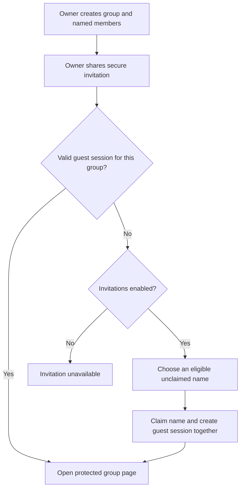
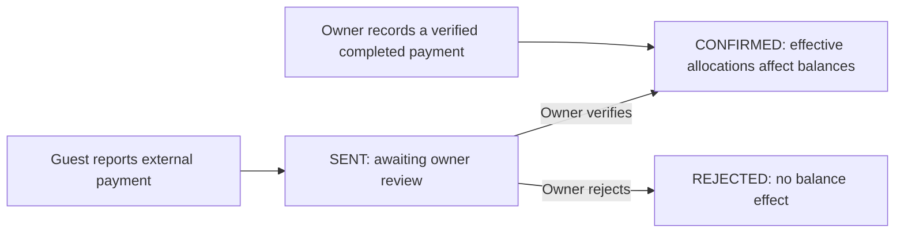
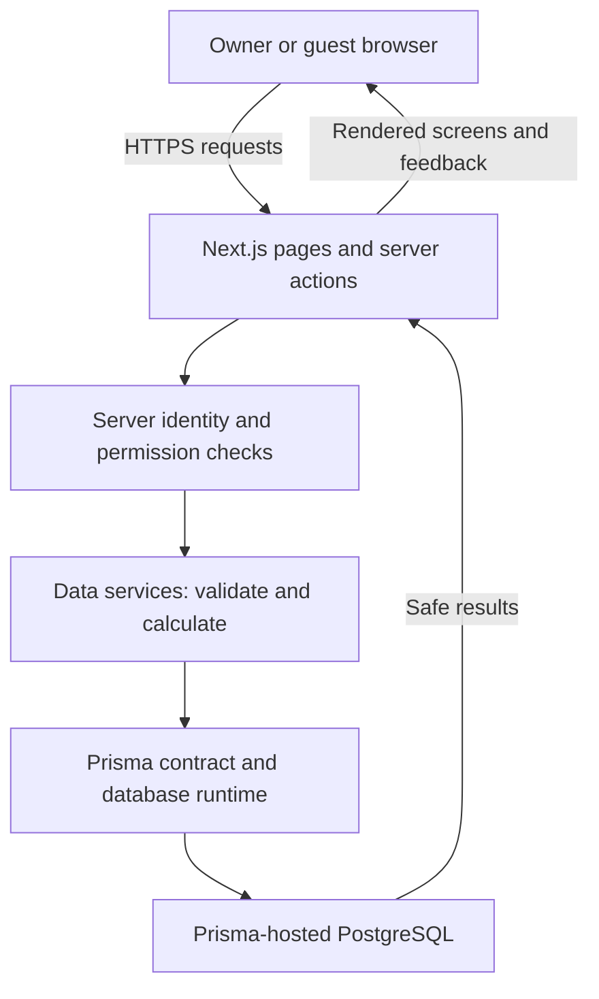

# How SPLITMate works

SPLITMate keeps a shared record of group expenses and repayments. An expense records who initially paid; a repayment records money subsequently transferred between members outside the app. The owner oversees the group, while guests can participate without accounts.

## Contents

- [People and access](#people-and-access)
- [Creating and joining a group](#creating-and-joining-a-group)
- [Expenses and splits](#expenses-and-splits)
- [Understanding balances](#understanding-balances)
- [Repayments and owner review](#repayments-and-owner-review)
- [Reconciling older payments](#reconciling-older-payments)
- [Editing and deletion](#editing-and-deletion)
- [Activity and presentation](#activity-and-presentation)
- [Developer reference](#developer-reference)

## People and access

An account (`User`) and a person's place in a group (`GroupMember`) are different things. Hamdi has an account and is also a member of Friday Football. Ismaeel can be a member of that group without an account. Every expense, share and repayment belongs to group-member identities, so guests have the same financial history as account holders. A future optional account must link to the existing membership, not replace its history.

A session is the secure browser credential that remembers who someone is. Owner and guest sessions are separate. A group link identifies a group; it is not proof that the visitor is a particular member. The server checks identity and permission on every protected action, even when a button is hidden.

| Action | Owner | Claimed guest |
| --- | --- | --- |
| Create groups and view an account dashboard | Yes | No |
| View their group's members, expenses, balances and activity | Yes | Yes, with a valid session for that group |
| Add an expense; select active payers/participants | Yes | Yes |
| Edit or delete a saved expense | Yes, including guest-created expenses | No |
| Report their own repayment | Owner can record completed payments directly | Yes; awaiting owner review |
| Confirm/reject reports; record completed payments between members | Yes | No, even when the guest received the money |
| Reconcile historical payment associations | Yes | No |
| Permanently delete the group | Yes, after explicit confirmation | No |

Financial actions require an active member identity in the same group. A member ID supplied by a browser is never sufficient authorization. Owner-only group deletion checks the authenticated account and group ownership rather than trusting a membership role alone.

## Creating and joining a group

The owner registers, signs in, opens `/groups/new`, names the group and adds guest names. The server creates the group, an already-claimed owner membership, unclaimed guest memberships and a `GROUP_CREATED` activity entry together. A failure rolls all of these back rather than leaving half a group. A random reusable share token is generated on the server.

Group and member names are trimmed, repeated whitespace is collapsed, and names must be 1-100 characters. Names must be distinct after Unicode compatibility normalization and lowercase comparison, including the owner's name; use initials to distinguish people with the same name. Groups support GBP, an optional description of up to 1,000 characters and 0-50 guests. A group with only its owner is valid. Unknown input fields, client-supplied owner IDs, roles and tokens are rejected. Successful submission returns to the dashboard. Separate successful submissions can still create separate groups.



Guests choose existing names; they cannot invent names during claiming. Eligible names are active, unclaimed MEMBER records without linked accounts. Competing claims are guarded so only one can succeed. Claiming records the time, creates a guest session and adds `MEMBER_CLAIMED` activity in one transaction.

One guest identity is remembered per browser. Signing out revokes that browser's guest session but does not release the name or sign out an owner account. Losing or expiring the cookie also leaves the name claimed. Recovery and multiple-group guest-session management are outstanding work in the [roadmap](dev-roadmap.md).

Disabling invitations prevents new claims but preserves access for existing valid guests. Inactive membership blocks access. Changing the share token would invalidate the old URL, including for existing guests using it. Owner controls for disabling/regenerating links are not yet available. Share links only with intended members.

## Expenses and splits

An owner or guest enters a description, amount, payer and participants, then reviews the split before saving. The current member is the default payer, but another active member may have paid. The payer need not participate: Hamdi can buy tickets only for Ismaeel and Jaher. Active members who have not claimed their names can still pay or receive shares.

Amounts use integer pennies for calculation, avoiding decimal rounding errors. Equal splitting assigns any leftover pennies in ascending internal member-ID order, regardless of checkbox order. £10.00 across three members becomes £3.34, £3.33 and £3.33. Even 1p can be split as 1p, 0p and 0p. Custom shares can include zero but must add up exactly to the total; Reset to equal restores the deterministic split.

The server requires a 1-1,000-character description, GBP 0.01 to GBP 999,999,999.99, at most two decimal places, and 1-51 distinct participants. It rejects negative shares, extra precision, currency symbols, commas, scientific notation, duplicate IDs and members from another group. Every selected participant must have exactly one share. Currency comes from the group.

Review does not save records. Confirmation rechecks identity, membership and all amounts, then saves the expense, every share and `EXPENSE_CREATED` activity together. The activity actor is the person submitting, who may differ from the payer. Shares matching the equal baseline are labelled EQUAL; other valid shares are CUSTOM. For new expenses, Back and edit preserves details and starts a new equal split. A failed save preserves proposed values where a fresh authorized review remains possible. Leaving the page discards the draft.

Each new expense form gets one random request key, retained through review, Back and edit, validation errors and uncertain submission responses. Retry in the same form after a lost response; do not open a new expense just to retry. A known successful save whose refresh fails offers a link back to the group.

A matching retry returns the original expense without adding shares or activity. Matching uses the authenticated member, group, trimmed description, exact pennies, payer and participant shares sorted by member ID. Equivalent amount formatting and participant order therefore match; changed details with a saved key are rejected. Different keys deliberately permit identical expenses. The key never grants access: sessions and group authorization are checked again after waiting for the group lock.

The original creation snapshot is retained separately from editable expense fields. Retrying after an edit returns the original ID without overwriting the edit; retrying after deletion does not restore the expense or its excluded payment allocations. Saved-expense editing does not submit creation keys. Historical expenses have no invented request keys. This behavior requires the expense-request migration described in [database design](database-design.md#expense-request-migration-deployment).

## Understanding balances

A ledger is the complete set of expense and payment records used to calculate balances. For each member:

```text
Net balance = active expenses paid - active expense shares
            + effective confirmed repayments sent
            - effective confirmed repayments received
```

Positive means the member is owed money; negative means they owe money; zero means even. "Active expenses" here means expenses that have not been deleted. An effective repayment amount is the part allocated to expenses that have not been deleted. Pending and rejected payments never change the balance.

For example, Hamdi pays £30 for himself, Ismaeel and Jaher with £10 shares. Hamdi is owed £20; the others each owe £10. Ismaeel reports sending £10: balances remain unchanged until the owner confirms it. After confirmation, Ismaeel is even and Hamdi is owed £10.

Totals include the complete ledger, even though the expense list shows only the latest 50 entries. Historical inactive members retain their financial effects. The dashboard shows each group's owner balance and separately totals amounts owed to and owed by the owner; it does not hide one by subtracting the other. Each group is read consistently, but the dashboard is not one simultaneous snapshot across all groups.

Invalid records or unresolved confirmed payments make balances unavailable rather than misleadingly partial. If any owned group cannot provide a reliable owner balance, both dashboard summary totals are unavailable. Empty valid groups show zero.

## Repayments and owner review

A payment allocation says which expense a repayment covers. For example, Ismaeel can allocate a £15 repayment as £10 for football and £5 for dinner, provided Hamdi paid both expenses and Ismaeel participated in both. Up to 500 allocations are supported per payment, and their positive penny amounts must exactly equal the payment total.



Owner confirmation is the agreed product behaviour, including transfers between two other members. The owner should verify those transfers with their recipients. Guests cannot confirm their own debts or payments received. The app does not verify bank transfers itself.

New payments require distinct active sender/recipient members, outstanding debt and credit, valid expense associations and available capacity. Pending reports reserve the corresponding debt and credit to prevent overlapping reports from claiming the same capacity. Rejection releases the reservation. Confirmation checks the current ledger again; a stale report fails safely rather than silently changing its amount. Owners may reject stale reports involving inactive members, but new payments and confirmations require active participants. An equivalent pending report directs the owner to review that report instead of recording another transfer.

Each creation request has a unique retry key. Retrying the same group, actor, creation mode, members, amount and original allocations returns the existing payment; changing those details with the same key fails. Errors retain the key and entered values, including after an uncertain response. Acknowledged success clears the form and rotates the key. Reloading or opening a new form starts a new intent, so check payment history before creating a fresh report after a crash. Repeated identical review decisions do not create another event. Confirmed/rejected statuses cannot currently be reversed.

## Reconciling older payments

Older payments may lack expense associations. Reconciliation means the owner identifies those associations from actual evidence, rather than the system guessing from names, dates or amounts. The owner uses Reconcile/Review associations in payment history. The original amount, sender, recipient and status stay unchanged; old and new associations are recorded in activity.

An unresolved confirmed payment makes the group's balances unavailable. An unresolved pending report retains its reservation. Either unresolved pending or confirmed payments block expense deletion and financial edits because the app cannot know which expense they affect. Rejected payments do not block those changes. Description-only expense edits remain possible.

Reconciliation can preserve known historical overpayments without rewriting the transfer amount. It still requires existing expenses paid by the recipient and shared by the sender. Older netted transfers (one payment settling several people's debts indirectly), or transfers for expenses previously permanently removed, may not satisfy those conditions. These cases remain unresolved and need investigation and a separately reviewed recovery approach. Do not invent expenses or associations to bypass the blocker.

Previously excluded allocations cannot be moved or revived. Version checks reject an old reconciliation form after another change, including when values were changed and later changed back.

## Editing and deletion

### Editing a saved expense

Only the owner can edit saved expenses, including ones entered by guests. The original shares load into the review. Changing the total does not silently redistribute them; new participants start at zero and removed participants leave the proposed split. The owner must resolve the remainder before saving. Back/edit preserves custom allocations.

Inactive members may retain their existing historical payer/participant roles but cannot be newly selected in another role. Payment associations also constrain edits: an owner cannot change a linked payer, remove a linked payment sender from participants or reduce their share below pending/confirmed allocations without resolving the associations based on actual history.

The expense ID and original creation date survive editing. A version based on the saved expense, shares and latest audit event prevents an old browser tab from overwriting or deleting a newer version, even if values were later restored. A duplicate edit is rejected as stale and requires reopening the expense. Refreshing the edit route resets its draft when the saved version changes, preventing old inputs from being paired with a new version.

### Deleting one expense

Expense deletion is a soft deletion: it disappears from ordinary lists and balances, but its original record, shares and identifying activity remain for audit. Repeating a completed deletion does not add another event. There is no restoration path.

Linked repayments remain visible with their original amounts and statuses. Only allocations for the deleted expense are excluded from balances and pending reservations. Other allocations continue to count. Each affected payment gets an exclusion activity entry.

For example, a confirmed £15 payment covers £10 football and £5 dinner. Deleting football excludes its £10 allocation; dinner's £5 still counts. If a single expense was fully settled and it is then deleted, both its expense shares and linked payment effects disappear from balances, leaving those members even for that expense. This is not a refund instruction or a claim that the bank transfer was reversed.

A pending report with some excluded allocations requires fresh owner review before its remaining amount can be confirmed. A report whose allocations are all excluded cannot be confirmed. An old confirmation form cannot revive an excluded amount.

### Permanently deleting a group

Group deletion works even with invitations disabled or a non-GBP group. The owner can confirm deletion in a dialog that names the group and warns about permanent removal. Cancel receives focus first; Escape cancels when idle. During submission, controls prevent repeated requests and errors remain visible for retry.

This removes the group, all expenses (including soft-deleted ones), shares, payments, allocations, activity, members and guest sessions together. No group-deletion activity is retained because the whole history is removed. Other groups, accounts and owner sessions remain. Existing guest credentials and invitation links stop working; cookies on other devices may remain but no longer authenticate. After deletion the owner returns to the recalculated dashboard. A repeated deletion request reports the group unavailable.

## Activity and presentation

Activity identifies the responsible member and affected object. Group pages show up to 10 recent events; the dashboard shows the latest five across owned groups. Guest-visible events include creation/claim/member changes, expense creation/update/deletion, payment sent/recorded/confirmed/rejected, reconciliation and allocation exclusions. Owner account details, session credentials and payment retry keys are not exposed.

Expense rows show payer, total, date and expandable shares. Member cards show balances, optional breakdowns and relevant payment controls; payment history is separate. Mutation responses refresh the owner group, guest group and dashboard data. Another open browser must refresh; there is no live push.

A shared light/dark control remembers a valid preference locally or follows the device setting until the user chooses. Storage failures fall back to an in-page preference. The 44px native toggle works before React becomes interactive, with compatibility for older media-query listeners. Disclosures keep forms mounted so closing a breakdown does not discard retry keys or drafts. Browser/accessibility verification limits belong in [tests.md](tests.md).

## Developer reference

### Runtime and source boundaries



Next.js App Router hosts UI, route handlers and Server Actions; there is no separate FastAPI backend. React and Tailwind provide presentation. Database code stays server-side.

| Location | Responsibility |
| --- | --- |
| `src/app/` | Pages, HTTP routes and actions; explicit owner/guest entry points |
| `src/components/` | Shared forms, review, history, members and theme controls |
| `src/data/` | Authorized group, guest, expense, balance, payment and deletion services |
| `src/lib/auth/` | Credentials, session lifecycle, HTTP validation and safe errors |
| `src/lib/expenses/`, `src/lib/payments/` | Exact money, validation, allocation and eligibility helpers |
| `src/prisma/` | Authored contract, generated artifacts and database runtime |
| `tests/` | Node tests and isolated runtime/database doubles |

### Routes and requests

| Route | Boundary |
| --- | --- |
| `/`, `/register`, `/login` | Session-aware landing and account access; allowed login return paths are dashboard/group creation |
| `/api/auth/register`, `/api/auth/login`, `/api/auth/logout` | Validated POST endpoints |
| `/dashboard`, `/groups/new`, `/api/groups` | Owner dashboard and session-derived group creation |
| `/groups/[groupId]` | Owner-only detail; no `/groups` index exists |
| `/groups/[groupId]/expenses/new` | Active owner member creates expenses |
| `/groups/[groupId]/expenses/[expenseId]/[operation]` | Owner edit/delete, scoped to the group |
| `/groups/[groupId]/payments/[paymentId]/reconcile` | Owner reconciliation |
| `/g/[shareToken]` | Invite or redirect for an existing same-group guest |
| `/g/[shareToken]/group`, `/g/[shareToken]/expenses/new` | Protected guest group and expense form |
| `/g/[shareToken]/joined` | Compatibility redirect to the protected group |

`POST /api/groups` enforces same origin, JSON content type and a 16 KiB body limit. `requireUser()` supplies the owner ID to `createGroup`; success returns HTTP 201 with only id/name/description/currency/createdAt. Expected failures return safe structured errors; database internals are not exposed. Dashboard projections exclude share tokens; the authorized owner detail service may return one for copying.

Owner and guest expense routes deliberately choose their authentication mode; having both cookies never silently switches identity. Server Actions use Next.js action request protection and revalidate identity and input. Guest pages are dynamic with noindex/no-referrer metadata; failed access redirects safely without private lists.

### Session security

| Detail | Owner | Guest |
| --- | --- | --- |
| Lifetime | Eight hours | 30 days, not extended by activity |
| Database relationship | UserSession to User | GuestSession to GroupMember |
| Access | Verified account and Group.createdBy | Matching active, claimed MEMBER with null userId |
| Sign-out | Revoke browser owner sessions | Revoke browser guest sessions, preserve claimedAt |

Both session types use 32 random bytes, canonical base64url validation and SHA-256 token hashes in storage. Cookies are separate, host-only, HttpOnly and SameSite=Lax; production uses Secure and `__Host-`. Owner issuance also supports HTTPS development cookies; guests use local cookies outside production. Invalid/expired credentials fail closed. Cookies are cleared only after successful revocation, not mutated during Server Component rendering.

Registration normalizes email and uses bcrypt cost 12. Passwords are not trimmed; the minimum is 15 characters and maximum 72 UTF-8 bytes. Registration does not issue a session. Logs must never expose passwords, hashes, tokens, cookies or connection strings.

Guest activity timestamps update at most once per five minutes with observed-value guards against overwriting newer values. These updates do not extend expiry or create page-view events.

### Consistency under simultaneous requests

A transaction groups writes so they all succeed or all roll back. Financial operations take a guarded no-op group-row update before reading or changing the ledger; this obtains a database lock, making cooperating requests wait their turn. Required member rows are locked in ID order. Payment and management operations recheck authentication after waiting. Claiming uses guarded `updateAll()` writes; this Prisma RC's single-row `update()` first resolves an ID and is not used for those guards.

Financial reads also take the group lock, with write overhead and possible contention. The RC exposes callback transactions without an isolation-level option. All future mutation paths must follow the lock and append-only audit convention; direct SQL bypassing it falls outside the guarantee. Lists/activity are separate reads, not a whole-page snapshot. Complete-ledger reads use memory proportional to history. Real PostgreSQL contention and rollback remain unverified; simulated tests are not proof of those behaviours. See [verification scope](tests.md).
