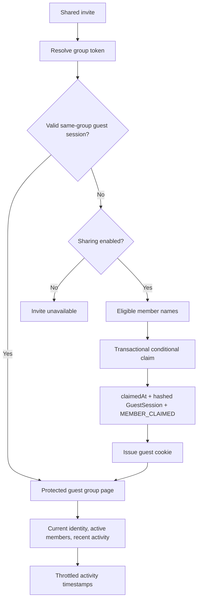
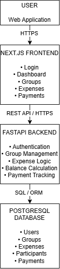

# SPLITMate Architecture

## Runtime and identity

Next.js App Router hosts pages, route handlers, Server Actions and server-only data services. React and Tailwind provide the UI; `src/prisma/db.ts` connects the pinned Prisma 8 RC runtime to Prisma-hosted PostgreSQL. There is no separate FastAPI backend.

A User is an account; a GroupMember is an identity inside one group. Only owners require accounts. All financial relationships reference GroupMember, including guests with null userId.

## Authentication

| Concern | Owner | Guest |
| --- | --- | --- |
| Establish identity | bcrypt-verified login | Claim an eligible owner-defined member through an enabled invite |
| Session model | UserSession → User | GuestSession → GroupMember |
| Expiry | Eight hours | 30 days; activity does not extend expiry |
| Cookie | Owner-specific host-only HttpOnly cookie | Separate guest-specific host-only HttpOnly cookie |
| Access check | Verified owner ID and Group.createdBy | Valid session, active claimed MEMBER with null userId, matching group |
| Sign-out | Revoke browser owner sessions, clear owner cookies | Revoke browser guest sessions, clear guest cookies; preserve claimedAt |

Both session types use 32 random bytes and store only SHA-256 token hashes. Shared helpers validate canonical base64url tokens. Cookies use SameSite=Lax; production uses Secure and the `__Host-` prefix. Owner issuance also supports an HTTPS development cookie. Guest issuance uses the local cookie outside production.

Registration normalizes email and hashes passwords with bcrypt cost 12; passwords are not trimmed and require 15 characters minimum, 72 UTF-8 bytes maximum. Registration does not issue a session. HTTP mutation endpoints enforce same origin; Server Actions use Next.js's action request protection and revalidate identity/input server-side.

Session reads reject malformed, missing, expired or unusable credentials. Server Components do not mutate cookies during rendering. Explicit sign-out clears cookies only after successful revocation.

## Guest flow

Claim eligibility is active, unclaimed, role MEMBER and null userId, in the group resolved from the token. Conditional `updateAll()` writes retain guards in SQL: the group write coordinates claiming with link changes, and the member write prevents two successful claims. Session/event creation shares the transaction. This RC's single-row `update()` first resolves an ID, so it is not used for these guarded writes.

Sharing controls new invitations, not existing membership. Disabling sharing preserves valid guest access; inactive membership blocks it. Rotating a token would make old URLs unresolvable, including for existing guests. Rotation/disable UI is not implemented.

## Routing and data boundaries

| Route | Behaviour |
| --- | --- |
| `/` | Session-aware landing actions |
| `/register`, `/login` | Owner authentication; allowed return paths are dashboard/group creation |
| `/dashboard` | Owned groups, separate owed/owing totals, per-group owner balances, active-member counts and latest five owned-group events |
| `/groups/new` | Owner-only creation form → POST /api/groups |
| `/groups/[groupId]` | Ownership checked server-side; active members, latest 10 events and share UI |
| `/groups/[groupId]/expenses/new` | Owner session and active OWNER GroupMember required; shared expense form |
| `/g/[shareToken]/expenses/new` | Matching active claimed guest session required; same shared expense form |
| `/g/[shareToken]` | Invite; existing same-group guests redirect to /group even when sharing is disabled |
| `/g/[shareToken]/group` | Matching guest session required; failures redirect to invite without private lists |
| `/g/[shareToken]/joined` | Compatibility redirect to the protected /group destination |

Successful claims go directly to the guest group page. Guest sign-out returns to the invite without making the identity claimable again. Invalid token paths use a fixed safe destination. Unexpected protected-group/action failures produce generic messages.

Guest output contains group/current-member identity, active member names/joined status, the latest 50 expenses and up to 10 events ordered by timestamp and ID descending. Allowed events are GROUP_CREATED, MEMBER_CLAIMED, MEMBER_ADDED, MEMBER_REMOVED, EXPENSE_CREATED, PAYMENT_SENT, PAYMENT_RECORDED, PAYMENT_CONFIRMED and PAYMENT_REJECTED. Other event types need an explicit visibility decision. Owner account data and authentication fields are excluded. Expense lists expose only description, amount, payer name, date, ID participant count, split method and participant IDs/names/amounts; inactive payers retain their historical display name.

Guest group reads and activity updates share a transaction. lastSeenAt and lastActiveAt each refresh when at least five minutes old; observed-value guards avoid overwriting newer timestamps. No page-view ActivityEvents are created. Guest pages are dynamic and set noindex/no-referrer metadata.

## Expense validation, review and persistence

`src/data/expenses.ts` provides a read-only `getExpenseFormContext` service. The owner route explicitly chooses owner authentication; the guest route chooses guest authentication. Having both cookies never silently switches identities. The service resolves credentials itself, checks ownership for owners and same-group membership for both flows, then loads active members in addedAt order with ID as a tie-breaker. Active unclaimed guests remain valid payer/participant options.

The client receives only the group name/currency, current member ID/name and active member IDs/names. Account IDs, session details, share tokens and activity fields are excluded. Disabled invitations preserve existing guest access, following the existing policy. No expense context reads write activity or financial records.

Both pages render `ExpenseForm`, with description, amount, a payer select defaulted to the current GroupMember and independent participant checkboxes. Route-bound Server Actions call `previewExpense` to calculate a review. The shared ExpenseReview shows description, total, payer and editable amounts beside participant names. BigInt totals show assigned and remaining amounts; save is disabled unless valid nonnegative shares match the total exactly. Reset to equal restores the server baseline. Participant display order follows the group member list, independently of remainder allocation. Back and edit preserves expense details and starts a new equal split; confirm and save calls `createExpense`, then redirects to the appropriate group page after commit. Pending buttons reduce accidental repeat clicks. Entries are not retained after leaving the page.

Validation trims descriptions (1–1000 characters), requires a positive GBP amount with at most two decimal places (£0.01–£999,999,999.99), and requires 1–51 distinct participants. Scientific notation, currency symbols, commas, duplicate IDs, malformed IDs, inactive members and foreign-group members are rejected. The payer may be outside the participant selection. Active unclaimed guests may pay or participate. Currency comes from the group; other currencies are rejected in this milestone.

`money.ts` converts decimal text to integer pence with BigInt arithmetic. Equal splitting sorts by ascending GroupMember ID, divides the pence total and gives one extra penny to the first remainder-count members. £10.00 across three members becomes £3.34/£3.33/£3.33, independent of selection order. Tiny totals may produce zero-pence shares (1p across three is 1p/0p/0p). Exact pound strings go to existing Decimal columns; no JavaScript floating-point pound arithmetic is used.

Save authenticates again and validates each proposed share: every selected participant must appear exactly once, no additional member is allowed, amounts must be nonnegative decimal strings with at most two places, and their integer-pence sum must equal the expense total. It persists these exact validated amounts. Actor IDs, redirect URLs and previous action state are not trusted. A failed save retains proposed values alongside a freshly authorized review where possible. The confirmation flag expresses the UI action, not authorization. A previously loaded form context is not authority to write financial data.

One `db.transaction` covers validation, the Expense with splitMethod EQUAL when shares match the deterministic baseline, otherwise CUSTOM, every ExpenseParticipant and EXPENSE_CREATED. The event actor is the authenticated GroupMember, which can differ from the chosen payer. A guarded no-op group update locks currency and serializes group expense saves. Selected membership rows are locked in ID order using guarded updateAll calls so they stay active and in-group until commit. Any failed write throws and rolls back all records. Review requests never write records. Locking behaviour still needs live PostgreSQL concurrency verification.

`getExpensesForGroup` in `src/data/groups.ts` is an internal read helper called only after group authorization. It batches payer and participant reads and returns the latest 50 expenses with deterministic date/ID ordering. Both group pages use the same `ExpenseList` component with expandable persisted shares in natural member order. Shared MemberList and ActivityList components provide joined/waiting states, current identity and consistent cards. Responsive group headers put Add expense beside the group identity.

## Member balances and repayments

`src/data/balances.ts` reads complete expenses, batched shares and all payment history. Net = expenses paid - allocated shares + confirmed repayments sent - confirmed repayments received. The existing money parser validates individual amounts; BigInt pence preserves exact aggregate arithmetic beyond the single-expense bound and Number safe-integer limit. Pending/rejected payments have no financial effect. Expense allocations must reconcile; unknown payment statuses, invalid money, duplicates and foreign/missing members produce an unavailable balance state. Historical inactive participants remain included, even when their only history is a payment. No values are silently repaired.

`getLedgerForGroup` is internal, not a public endpoint. Owner/guest group services authorize first, then call it within a transaction (the helper starts one when none is supplied). It takes the same guarded no-op GBP group-row update lock used by expense saves **before** reading expenses, shares and mutable payment statuses. Balances and returned payment history therefore share a consistent financial view under cooperating application writes. `src/data/payments.ts` holds that lock through balance validation, payment mutation and activity recording. Authentication is rechecked after lock acquisition; owner session reads accept the transaction connection to avoid needing another pooled connection while holding a lock.

The installed Prisma RC exposes callback transactions, but no isolation-level option. The group lock serializes finances within a group and is held until commit/rollback; financial page reads therefore issue a no-op UPDATE, with row-lock contention and write overhead. Group/member fields keep the same values. All future expense/payment mutation paths must obey this protocol; direct SQL writers bypassing it are outside this guarantee. Existing expense lists/activity panels are separate reads and are not a whole-page snapshot. Actual PostgreSQL concurrency has not been verified. Full-ledger reads use memory proportional to group history; there is no per-member read query.

Guests report payments only from their authenticated active GroupMember. Owners can record confirmed payments between active members, including unclaimed members. Sender must owe money, recipient must be owed money, both must be in the group and distinct, and amounts must be positive GBP with at most two decimal places. Pending outgoing reports reserve sender debt; pending incoming reports reserve recipient credit. Confirmation excludes its own reservation but checks other reservations and current balances. Stale reports fail without changing their amount; the owner may reject them to release reservations. A matching pending sender/recipient/amount blocks direct recording and guides the owner to confirm the existing report.

Statuses are SENT (Awaiting confirmation), CONFIRMED and REJECTED. Only the owner can move SENT to either terminal status; terminal payments cannot be reversed. Repeated identical decisions succeed without another event. Owners should verify third-party transfers with their recipients. An owner may reject a report involving inactive members, but new payments and confirmations require active sender/recipient/actor records, locked in ID order. Historical confirmed payments continue to count after deactivation.

Creation uses a UUID request key backed by a database unique constraint. A retry checks group, actor, creation mode, sender, recipient and amount against the original record and returns it without another write/event. Reusing a key with different details fails. Forms retain values and key after an error/lost response; a successful save rotates the key. Reloading or opening another form starts a new intent, so a new key is not proof that an external payment happened twice. Pending reservation limits and the equivalent-report check provide additional protection, but the app cannot verify real-world transfers.

Creation, confirmation and rejection write PAYMENT_SENT, PAYMENT_RECORDED, PAYMENT_CONFIRMED or PAYMENT_REJECTED activity with the actual authenticated actor in the same transaction. Guarded status updates prevent repeated application. The payment row retains recorder/reviewer identities and review time. Safe public history omits idempotency and audit identity fields.

`payment-panel.tsx` provides shared report/direct forms, history, owner-only review controls, pending/error/success states and text status labels. `balance-list.tsx` displays paid/share, confirmed sent/received and net totals. Payment Server Actions revalidate both owner and guest group paths; successful client actions refresh the current route. Another open browser must refresh to see changes; there is no live push. SPLITMate records external payments and does not transfer money or suggest settlements.

The payment migration was applied to the configured database on 18 October 2026; schema and contract-marker verification passed. See [database design](database-design.md) for deployment requirements and [testing evidence](tests.md) for the distinction between mocked and live checks.

## Limits and next work

One current guest cookie per browser; no session recovery, identity switching or multi-group guest-session UI. Rate limiting and live database concurrency/rollback testing remain outstanding. Group creation has no server-side idempotency guarantee.

Expense submission has no durable idempotency key: a replay or retry after a lost successful response can create another expense. Pending UI does not guarantee exactly-once saving. Expense editing, percentage splits and transfer suggestions are not implemented. The user has manually verified owner/guest payment flows and dashboard balances. Next: verify PostgreSQL concurrency in a designated test environment and address expense-submission idempotency. See [testing evidence](tests.md), [owner data flow](group-creation.md) and [database design](database-design.md).

---

Historical original notes - not current implementation

## Original notes — preserved

The following notes are retained as originally written. For current implementation status, use the dated update above.

## Overview

SplitMate will use a client-server architecture consisting of a web frontend, REST API backend and relational PostgreSQL database.

The frontend will be responsible for presenting the user interface and communicating with the backend through HTTPS requests.

The backend will contain the application's business logic, including expense calculations, balance calculations, group management and payment tracking.

PostgreSQL will provide persistent storage for users, groups, expenses and payments.

## Planned Architecture

The main components are:

* **Frontend:** Next.js, React and TypeScript
* **Backend:** Python and FastAPI
* **Database:** PostgreSQL
* **API:** RESTful API
* **Version Control:** Git and GitHub

## Data Flow

When a user creates an expense, the frontend sends the expense information to the FastAPI backend through the REST API.

The backend validates the request, calculates the relevant participant shares and stores the expense and participant information in PostgreSQL.

When the user views their group balance, the backend retrieves the relevant expenses and payments and calculates their current net balance.

## Design Considerations

A relational database was selected because SplitMate contains several strongly related entities, including users, groups, expenses, participants and payments.

The application will separate presentation, business logic and data storage to make the system easier to maintain, test and extend.

### Dashboard financial totals

The dashboard resolves the active OWNER GroupMember by group ID and authenticated user ID, never by name. It reuses `getLedgerForGroup` in sequential single-group transactions, retaining the existing group-lock protocol. Each ledger is consistent; the dashboard is not a simultaneous cross-group snapshot. Full histories feed signed BigInt-pence aggregation, keeping positive and negative group balances separate. Missing/ambiguous owner membership, unsupported currency, invalid ledgers or ledger read failures make both summary totals unavailable. Valid empty ledgers and empty dashboards show zero. Payment actions and expense creation invalidate `/dashboard`; only confirmed repayments affect totals.
