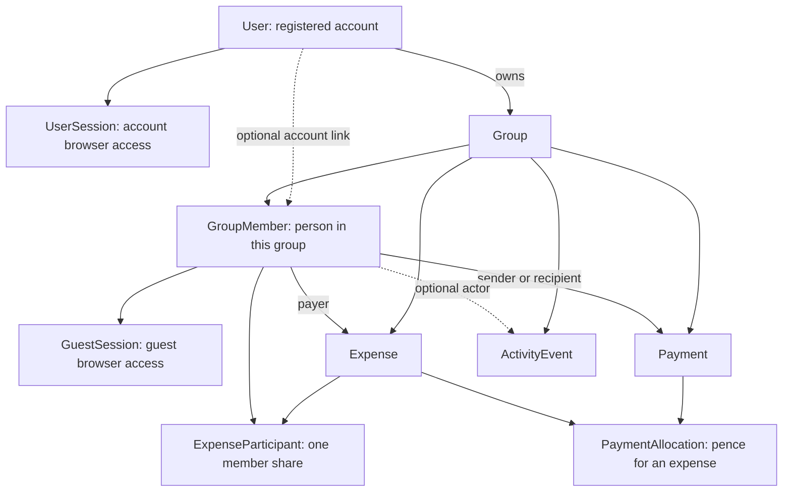

# SPLITMate database design

The database is the durable record of who belongs to a group, what was paid, each person's share and which repayments the owner has confirmed. It uses PostgreSQL, a relational database: related records are connected by identifiers rather than by matching people's names.

This guide explains the stored information and its protection. The [architecture guide](architecture.md) explains user journeys and financial rules; the [developer reference](#developer-reference) below contains exact source locations and operating procedures.

## Contents

- [What is stored and why](#what-is-stored-and-why)
- [How records relate](#how-records-relate)
- [Protecting financial history](#protecting-financial-history)
- [Developer reference](#developer-reference)

## What is stored and why

The authored contract currently defines ten models. A model describes a kind of record, such as an expense or member.

| Model | Information and purpose | Friday Football example |
| --- | --- | --- |
| User | Account name, unique email, password hash and creation time | Hamdi's registered account; the password itself is not stored |
| UserSession | Account link, hashed session token and expiry | Remembers Hamdi's signed-in browser |
| Group | Name, optional description, currency, owner account, unique share token, sharing flag and creation time | Friday Football, owned by Hamdi, using GBP |
| GroupMember | Group, display name, optional account link, role, claim/activity times and active state | Ismaeel belongs to Friday Football without an account |
| Expense | Group, description, amount, payer member, split method, creation time and optional deletion time | Hamdi paid £30 for a pitch |
| ExpenseParticipant | Expense, member and exact amount owed | Ismaeel's £10 share of that pitch |
| Payment | Group, sender/recipient members, amount, review state/times, retry key and audit identities | Ismaeel reported sending Hamdi £10 |
| PaymentAllocation | Payment, expense and exact amount in pence | 1,000 pence of that payment covers the pitch |
| ActivityEvent | Group, optional acting member, event type, description, affected object and time | Hamdi confirmed Ismaeel's payment |
| GuestSession | Member link, hashed session token, creation/activity times and expiry | Remembers Ismaeel's claimed identity on one browser |

A password hash is a one-way representation used to verify a password without retaining it. Session token hashes similarly avoid storing the raw browser credentials. Group share tokens are stored as unique tokens; they identify invitations and do not authenticate a particular member.

A User is not a GroupMember. Hamdi's account can own several groups, each with its own membership identity. Ismaeel's `userId` can be null, meaning no account is linked. All financial relationships point to GroupMember so guest participation never depends on creating an account.

## How records relate

The arrows below mean "contains or refers to", not a sequence of actions. The same payment can cover several expenses, and one expense can receive several repayments through allocation records.



For a £30 pitch split three ways, the app stores one Expense and three ExpenseParticipant records. A £10 repayment stores a Payment and a PaymentAllocation identifying the pitch. Confirming that payment changes its review state and records activity; it does not erase the original expense or alter the participants' shares.

The database rejects references to missing records and certain duplicates, such as adding the same participant twice to one expense. The application must also check business meaning: an existing member of another group is still an invalid payer for this group's expense. A database relationship alone cannot prove that a caller has permission.

## Protecting financial history

### Amounts and audit records

Expense amounts, shares and payment totals use exact database Decimal values. Calculations use integer pence; allocation amounts use BigInt, a whole-number type. This prevents fractional rounding errors such as losing a penny during a split. The [balance and allocation rules](architecture.md#understanding-balances) define which amounts count.

Activity records store a structured event type as well as readable text. The type, not the wording, determines the meaning. Related state changes and their activity entries are written together in transactions: either the complete change is saved or none of it is. The acting member can differ from the payer, so the history can explain who entered or reviewed a transaction.

Payment records retain who recorded/reviewed them and when. Older rows may lack newer audit fields; migrations do not invent missing history. Old payments without expense associations require explicit evidence-based reconciliation. Some historical transfers cannot yet be reconciled; their limitations are explained in [architecture](architecture.md#reconciling-older-payments).

### Removing an expense versus removing a group

| Action | What people see | What remains stored |
| --- | --- | --- |
| Delete one expense | It disappears from normal expense lists and calculations | The expense with `deletedAt`, its shares, payment history and identifying activity remain |
| Permanently delete a group | The group and its access disappear | No group financial/activity history remains; other groups and account records are preserved |

Deleting an expense is like crossing an item out while keeping the record of what happened. Linked payments are not erased or refunded. Their allocations to that expense stop affecting balances and pending reservations; allocations to other expenses still count. Excluded allocations are frozen and cannot be reassigned to undo the exclusion. There is no expense restoration path.

Deleting the whole group is deliberately different: after explicit owner confirmation, the app removes all of that group's dependent records, including soft-deleted expenses and guest sessions. It retains no deletion event within the removed group. Guest cookies on other devices may still exist, but the removed session records make them unusable. No cascading deletion should be introduced casually; the service uses an explicit dependency order.

Inactive membership does not erase financial history. Former participants remain represented in historical expenses and calculations. Optional account linking must keep the existing membership and its financial identity.

## Developer reference

The contract is the application's blueprint for stored records. Emitting it generates files the runtime and editor use. A migration is a separately reviewed change to the actual database structure; generating a contract does not apply that change.

### Authoritative files and configuration

| File | Responsibility |
| --- | --- |
| [src/prisma/contract.prisma](../src/prisma/contract.prisma) | Authored schema; authoritative model/field definitions |
| `src/prisma/contract.json`, `src/prisma/contract.d.ts` | Generated runtime contract and TypeScript types; regenerate and commit with approved schema changes, never hand-edit |
| [src/prisma/db.ts](../src/prisma/db.ts) | Application runtime using the generated contract and DATABASE_URL |
| [prisma.config.ts](../prisma.config.ts) | CLI configuration; loads dotenv and defaults its connection to DATABASE_URL |
| [package.json](../package.json) and package-lock.json | Dependency declarations and exact locked installation |
| `migrations/app/` | Migration history and local refs |
| `migrations/snapshots/` | Generated contract snapshots |

Use locked dependencies and the locally installed CLI. The documented RC toolchain is `prisma` 8.0.0-rc.13, `@prisma/orm-postgres` 8.0.0-rc.9 and `@prisma/cli-engine` 0.3.0. Package declarations use ranges; `npm ci` respects the lockfile. Do not automatically upgrade Prisma or use `npx prisma@latest`. Next.js configuration does not install an automatic contract-emission plugin; explicitly emit after approved source changes.

The canonical database is Prisma-hosted PostgreSQL. Use the existing pooled `DATABASE_URL` for application traffic and securely loaded direct `DIRECT_URL` for explicit administrative commands. Do not replace either with localhost, print credentials, commit environment files or alter sensitive configuration without approval. An empty DIRECT_URL is not an acceptable administrative target. The CLI's default configuration is not a substitute for explicitly selecting the intended administrative connection.

### Schema and application constraints

Primary keys are auto-incrementing Int values. Timestamps use `TimestamptzString`. Roles, payment statuses and event types are strings rather than database enums.

Unique constraints include User.email, Group.shareToken, both session tokenHash fields, ExpenseParticipant `(expenseId, memberId)`, Payment.requestKey when non-null, and PaymentAllocation `(paymentId, expenseId)`. PaymentAllocation has indexes supporting payment/expense references. Group member display-name uniqueness is an application creation rule, not a database unique constraint.

The application, under the group lock, enforces positive payment/allocation amounts, exact allocation totals, same-group relationships, expense payer/participant compatibility, permissions, status transitions and reservation capacity. These are not database CHECK constraints. Foreign keys must not be mistaken for those checks.

Expense editing/deletion versions use SHA-256 and include ordered shares and the latest expense audit-event ID. Reconciliation versions include its audit revision. Preserve the append-only activity and locking protocol when adding mutation paths. Financial reads also acquire the group lock; direct SQL writers bypassing this protocol fall outside its consistency guarantee. Real PostgreSQL contention and rollback require further verification, as recorded in [tests.md](tests.md).

Permanent group deletion removes GuestSession, PaymentAllocation, ExpenseParticipant, Payment, Expense, ActivityEvent and GroupMember records before Group, within one transaction. It scopes every operation to the group and preserves User/UserSession and other groups. See [group-deletion.ts](../src/data/group-deletion.ts).

### Reported migration state

This table records previously reported evidence, not a fresh database check and not proof that every environment is migrated.

| Migration | Purpose | Reported evidence |
| --- | --- | --- |
| `20260906T2009_initial_schema` | Initial database | Previously reported applied and verified |
| `20260913T2223_guest_members_and_activity` | GroupMember financial identities, guests and activity | Previously reported applied and verified; immutable |
| `20260917T1942_owner_user_sessions` | Owner sessions | Previously reported applied and verified |
| `20261018T0957_payment_reporting` | Payment retry/audit fields | Applied on the configured database on 18 October 2026; status, schema and full contract-marker verification reported successful |
| `20261022T2235_expense_payment_allocations` | PaymentAllocation and Expense.deletedAt | Supplied deployment report confirms successful application and schema verification on the configured database; deployment date is not specified in the supplied correction |

The allocation deployment report supersedes earlier "prepared but unapplied" notes. It does not establish browser behaviour, historical-payment reconciliation or real concurrency/rollback safety. Independently verify another environment before deploying application code that expects these fields.

The payment-reporting migration added ten operations: five nullable audit/idempotency columns, a unique request-key constraint, indexes and foreign keys. The allocation migration added seven operations for the allocation table, deletion timestamp and associated constraints/indexes. Both were additive, preserving existing rows without guessing historical values or associations. Offline migration validation was previously reported passing.

Relevant storage hashes for reviewed migration origins/targets:

| Contract stage | Storage hash |
| --- | --- |
| Owner sessions | `68a78b5e428f40a6abc3edbcfc0c5467e9dcf2e16fe8552a103abeac5354b988` |
| Payment reporting | `6164bc09235f61a5ae59c7e5d465734a240c6fc0c9f4d8da37a3c1d986e3dbde` |
| Expense payment allocations | `fac998bb7eb1661f1c59582e8485caee9e1a9532fece05aaa8a55d3a075a44c4` |

Earlier planning reported that the local `db` ref still pointed to the initial schema and therefore used an explicit current-contract origin. Do not treat a local ref or a historical hash as proof of live state, advance refs blindly or manually mark a migration applied. Inspect the intended database and approved migration path.

### Contract and migration workflow

Never automatically apply a migration. Applied migrations are immutable, especially `20260913T2223_guest_members_and_activity`; future changes require a new migration. Never assume affected tables are empty. Do not reset, truncate, remove or overwrite production data as a shortcut.

1. Inspect the authored contract, locked toolchain and actual target environment. Explain proposed file/schema changes and obtain required approval before changing or regenerating files.
2. Edit only the approved authored contract, then emit generated artifacts:

   ```powershell
   npx.cmd --no-install prisma contract emit
   ```

3. Inspect the emitter output. Generate a new migration plan with the locally installed RC CLI, using a verified origin and reviewed name. Confirm that version's plan/compile options before use; do not copy old `@latest` commands. Review the generated operations, destructive effects, existing data and any transformation/backfill requirements. Compile if needed and inspect the result.
4. Run offline validation:

   ```powershell
   npx.cmd --no-install prisma migration check
   ```

5. Securely load the intended nonempty DIRECT_URL, inspect migration status and preview the complete intended path. Review prerequisites separately, including locking from indexes/constraints and any reconciliation needed for historical data.
6. Explain the concrete preview and risks, obtain explicit deployment approval and apply only that approved path. Application code using new fields must not run against the old schema.
7. Check migration status and schema after application; use full contract-marker verification when required. Restart the development server to load regenerated contracts. Record the environment scope, date, commands/results and remaining limits without credentials.

The exact retained allocation-deployment commands below are a reference for an environment that still needs this migration, not an instruction to rerun an already applied migration.

Inspect first:

```powershell
npx.cmd --no-install prisma migration status --db "$env:DIRECT_URL"
npx.cmd --no-install prisma db migrate --show --to 20261022T2235_expense_payment_allocations --db "$env:DIRECT_URL"
```

Only after explicit approval and a matching safe preview:

```powershell
npx.cmd --no-install prisma db migrate --to 20261022T2235_expense_payment_allocations --db "$env:DIRECT_URL"
npx.cmd --no-install prisma migration status --db "$env:DIRECT_URL"
npx.cmd --no-install prisma db verify --schema-only --db "$env:DIRECT_URL"
```

Full schema/contract-marker verification, when required:

```powershell
npx.cmd --no-install prisma db verify --db "$env:DIRECT_URL"
```

For future migrations, select the newly reviewed target rather than reusing this allocation target. Preserve the distinction between an offline migration check, live schema verification and tests of real transactions under load.
